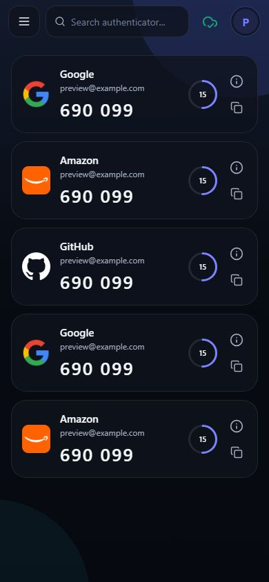
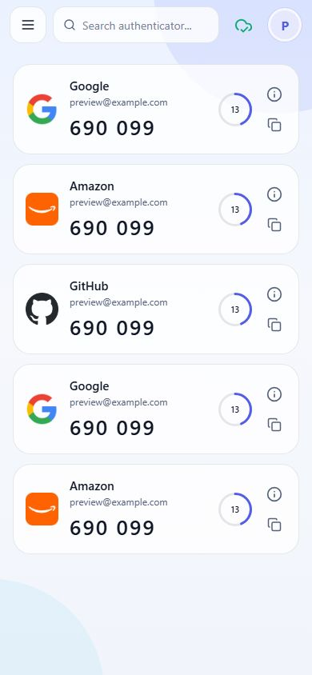
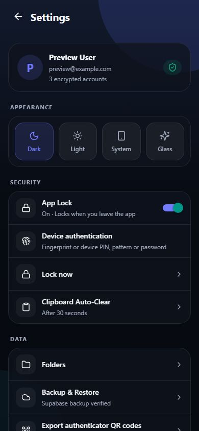

# MDX Authenticator

A dedicated Android authenticator with fast offline codes, encrypted local
storage, device authentication and optional encrypted Supabase backup.

[Features](#features) · [Security & recovery](#security-and-recovery) · [Support](https://mdx-authenticator.app/support)

## App preview

<table>
  <tr>
    <th>Dark appearance</th>
    <th>Light appearance</th>
    <th>Account & settings</th>
  </tr>
  <tr>
    <td></td>
    <td></td>
    <td></td>
  </tr>
</table>

*Screenshots use demo accounts. No real account setup keys are shown.*

This public repository contains product documentation and release information.
Application source is maintained privately. The installed app is **Authenticator**.

## Features

| | What you get |
| --- | --- |
| **Instant codes** | Offline TOTP/HOTP, live countdowns and one-tap copy |
| **Easy setup** | QR scanning, manual setup and 6/8-digit configurations |
| **Your accounts** | Search, edit and organize accounts in custom folders |
| **Device protection** | Optional biometric/PIN App Lock and fresh verification for setup keys and exports |
| **Cloud backup** | Google sign-in with automatic encrypted Supabase backup and restore |
| **Clear status** | Verified saves, syncing, pending changes and backup errors |
| **Independent backup** | Portable encrypted files and authenticator transfer QR codes |

Supports SHA1, SHA256 and SHA512. Service icons are bundled for offline use.

## Security and recovery

Local accounts use AES-256-GCM and a device-only key protected by Android
Keystore-backed storage. Code generation and account management work offline.
No new app password or recovery codes are created.

Optional cloud snapshots are encrypted before upload. Google sign-in identifies
the account, owner rules isolate backups, and Supabase Vault protects the
account-recoverable backup key. Authorized backend administrators can access
this key; cloud backup is **not zero-knowledge encryption**.

Older encrypted accounts may require their previous password once for migration.
Google sign-in cannot bypass their original encryption when the old key is lost.
Install updates over the existing app. Verify backups and test restoration
before uninstalling or replacing a phone: device-only local keys do not survive
an uninstall.

Historical releases may contain retired features. See the release notes for the
features included in each APK; this repository now presents the Authenticator app.

Do not post setup keys, QR codes, session tokens or backup-file passwords in issues.

Built by MD Tech Hacker.
